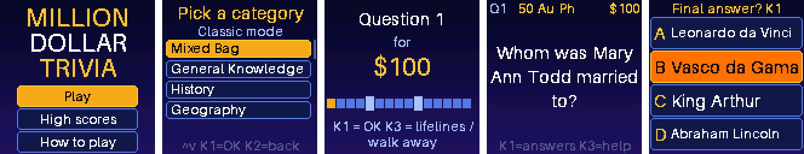

# Million Dollar Trivia

A "Who Wants to Be a Millionaire"-style trivia game for a tiny handheld: a Waveshare
RP2040-PiZero with the Waveshare 1.44" LCD HAT, running MicroPython, in a 3D-printed case.



*Screens from `tools/sim.py`, which runs the game code on a desktop (shown at 2x).*

* 15,292 multiple-choice questions in 16 categories (general knowledge, history,
  geography, science, nature, art history, music, movies & TV, literature, English,
  French, math, technology, politics, sports, video games), each easy, medium and hard
* Classic mode climbs a 15-question money ladder from easy to hard, with safe havens at
  $1,000 and $32,000; or play all-easy, all-medium or all-hard
* Lifelines (50:50, ask the audience, phone a friend), walk away at any time, and high
  scores with initials, per mode and category
* Text sized to fill the small screen: each question gets its own screen, answers use the
  largest font that fits, and anything still too long scrolls when highlighted

## Hardware

| Part | Notes |
| --- | --- |
| [Waveshare RP2040-PiZero](https://www.waveshare.com/rp2040-pizero.htm) | RP2040 with 16 MB flash, Raspberry Pi Zero form factor |
| [Waveshare 1.44" LCD HAT](https://www.waveshare.com/wiki/1.44inch_LCD_HAT) | ST7735S 128x128, 5-way joystick and 3 keys |
| PiSugar S | Optional battery board underneath, with USB-C charging and a power switch |
| `enclosure/` | 3D-printed case, keys, joystick cap and TPU bumper (see `enclosure/README.md`) |

The game also runs on the Waveshare 1.3" LCD HAT (ST7789, 240x240), which uses the same
pins and buttons; deploy with `HAT=1.3` and it uses a roomier layout.

Controls: the joystick moves, **KEY1** (top) is OK, **KEY2** goes back, **KEY3** opens the
lifelines and the walk-away option. On the answers screen, LEFT shows the question again.

## Setup

1. **Firmware.** Flash the official MicroPython v1.29.0 build for the Waveshare
   RP2040-Plus 16 MB, which has the same flash setup as the RP2040-PiZero and gives the game
   the full 15 MB of storage it needs:
   https://micropython.org/resources/firmware/WAVESHARE_RP2040_PLUS-FLASH_16M-20260824-v1.29.0.uf2
   (SHA-256 `654744919132d80f8095db8a5f5a641a8966d685f818dc66df0e14cdd7d2c1ba`).
   Hold BOOT while plugging the board in, then copy the .uf2 to the RPI-RP2 drive or run
   `picotool load -x <file>.uf2`.
2. **Tools.** Install [mpremote](https://docs.micropython.org/en/latest/reference/mpremote.html)
   and [uv](https://docs.astral.sh/uv/) (uv runs `mpy-cross` and the Pillow-based tools).
3. **Deploy.** Find the board's serial port with `mpremote devs`, then:

   ```
   PORT=/dev/cu.usbmodem101 tools/deploy.sh          # code, fonts and all questions (~3 min)
   PORT=/dev/cu.usbmodem101 tools/deploy.sh --code   # code only, keeps everything else
   ```

   The script builds the question bank, precompiles the code with `mpy-cross` (compiling
   on the board needs more RAM than it has), copies everything and restarts the board.
   High scores (`/scores.json` on the board) are never overwritten. It only installs onto a
   board that already has this game or a blank one; `FORCE=1` overrides.

## Repository layout

* `device/`: the game. `app.py` (menus), `game.py` (a game), `questions.py` (the bank on
  flash, one file per category and difficulty plus a byte-offset index for O(1) lookup),
  `scores.py`, `ui.py`, `font.py` (pre-rendered bitmap fonts), `hat.py` (display and
  button drivers for both HATs)
* `questions/<category>/<difficulty>.txt`: questions written for this game, one per line:
  `question|correct answer|wrong|wrong|wrong`
* `tools/build_questions.py`: builds the bank (`build/q/`) from those, from Open Trivia DB
  (`tools/fetch_opentdb.py`) and from OpenTriviaQA, checking every question against the
  screen limits and the font, removing duplicates and capping each file at 500
* `tools/classify_jev.py`, `tools/fix_apostrophes_jev.py`: how the OpenTriviaQA questions
  were rated. OpenTriviaQA has no difficulty levels and some stale answers, so TypeSafe's
  Jev model judged each question's difficulty, whether its answer is right, current and
  clear, and restored the apostrophes the source had lost. The results are saved in
  `tools/opentriviaqa/`, so rebuilding the bank needs no API key.
* `tools/make_fonts.py`: renders the bitmap fonts from Aileron, with hand-drawn accent
  marks so French letters stay distinct at 11 to 21 px
* `tools/sim.py`: runs the real game code on a desktop with Pillow and saves screenshots,
  for checking layouts without a board: `uv run --no-project --with pillow tools/sim.py 1.44 out/`
* `enclosure/`: STL files and G-code for the case

## Licenses

* Code (`device/`, `tools/`): MIT, see `LICENSE`
* Questions (`questions/`, `tools/opentdb/`, `tools/opentriviaqa/` and the bank built from
  them): CC BY-SA 4.0, see `questions/LICENSE`
* Enclosure (`enclosure/`): GPL-3.0, see `enclosure/LICENSE`
* Fonts: Aileron by Sora Sagano, public domain (CC0)

## Credits

* Questions from the [Open Trivia Database](https://opentdb.com) and
  [OpenTriviaQA](https://github.com/uberspot/OpenTriviaQA), both CC BY-SA 4.0; the rest
  were written for this game
* Display setup for the 1.44" HAT follows Waveshare's
  [1.44inch LCD HAT demo code](https://www.waveshare.com/wiki/1.44inch_LCD_HAT)
* The enclosure builds on SeedSigner's
  [Orange Pill enclosure](https://github.com/SeedSigner/seedsigner/tree/dev/enclosures/orange_pill)
  (MIT) and PiSugar's
  [1.44" LCD cap](https://github.com/PiSugar/pisugar-case-pihat-cap/tree/master/1.44inch_lcd_cap)
  (GPL-3.0)
* [Aileron](https://dotcolon.net/fonts/aileron/) by Sora Sagano
